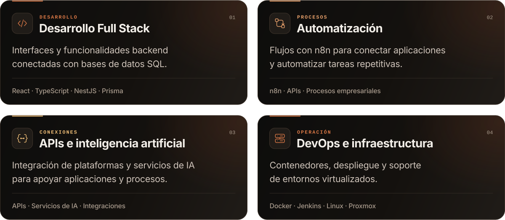
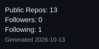

<picture>
  <source
    media="(max-width: 640px)"
    srcset="assets/hero-mobile.svg">
  
</picture>

  <a href="https://www.parzkeys.com/">Portafolio</a>
  &nbsp;·&nbsp;
  <a href="https://github.com/dhait0">GitHub</a>
  &nbsp;·&nbsp;
  <a href="mailto:sebascamargo39@gmail.com">Contacto</a>

## Sobre mí

Soy Sebastián Camargo, desarrollador Full Stack Junior enfocado en la automatización de procesos empresariales y la integración de APIs y servicios de inteligencia artificial.

En VADEL S.A.S. participo en el desarrollo de funcionalidades frontend y backend, diseño y mantengo flujos de trabajo con n8n e integro servicios para conectar aplicaciones y apoyar procesos empresariales.

Trabajo con React, TypeScript, Node.js, NestJS y Prisma, junto con bases de datos relacionales. También participo en pruebas, dockerización y despliegue con Git, Docker y Jenkins.

Mi experiencia en soporte de TI, Linux, Proxmox y virtualización me ayuda a conectar el desarrollo de software con las necesidades operativas de las personas y los sistemas.

## Lo que desarrollo

Desarrollo aplicaciones web, automatizo procesos con n8n, integro APIs
y servicios de IA, y participo en el despliegue y la operación de aplicaciones.

<picture>
  <source
    media="(max-width: 640px)"
    srcset="assets/especialidades-mobile.svg">
  
</picture>

## Proyectos destacados

### WebKitsunova Proyecto
Aplicación full‑stack unificada construida sobre Next.js 16 (App Router), React 19, Prisma, Supabase, Tailwind CSS y Vitest. Incluye server components, server actions, autenticación HTTP‑only mediante Supabase, pruebas con Vitest y despliegue local con Docker Compose y Postgres.
- **Stack real**: Next.js, React, TypeScript, Prisma, Supabase, Tailwind, Vitest, Docker
- **Enlace**: https://github.com/dhait0/webkitsunova-proyecto

### Nexus n8n Workflow Kit
Colección bilingüe de workflows importables de n8n para automatización empresarial, enrutamiento de incidentes, riesgo de proveedores, gobernanza de IA y sincronización tipo Microsoft Graph. Incluye placeholders seguros sin credenciales, validación local con Docker y documentación bilingüe.
- **Stack real**: n8n (JSON), Docker (para validación), Node.js (scripts)
- **Enlace**: https://github.com/dhait0/nexus-n8n-workflow-kit

### Forge CI Deploy Pipeline
Demo bilingüe de Jenkins, Docker y Linux para construir, probar, empaquetar, realizar pruebas de humo y simular rollback de un servicio TypeScript mock. Muestra un pipeline declarativo de Jenkins, builds Docker multi‑stage, pruebas de humo con Docker Compose y scripts de preflight Linux.
- **Stack real**: Node.js, TypeScript, Jenkins, Docker, Linux
- **Enlace**: https://github.com/dhait0/forge-ci-deploy-pipeline

## Tecnologías y herramientas

### Stack principal

### Otras herramientas de mi stack

Ver herramientas adicionales

## Actividad de GitHub

[Ver mi perfil de GitHub](https://github.com/dhait0)

## Contacto

---
*Hecho con ❤️ y ☕. Explora mi trabajo y contacta para colaboraciones.*
